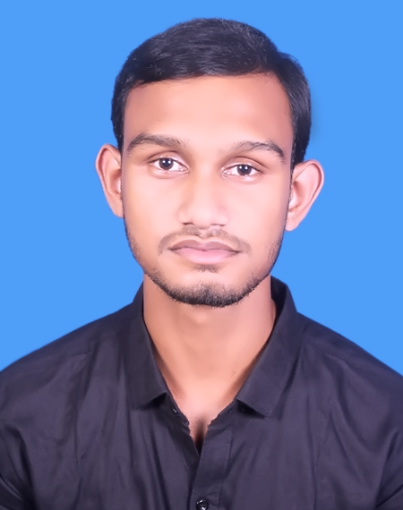

<!DOCTYPE html>
<html lang="bn">
<head>
<meta charset="UTF-8">
<meta name="viewport" content="width=device-width, initial-scale=1">
<meta name="description" content="আর এইচ রিফাত (R H Rifat)-এর ব্যক্তিগত জীবনী, শিক্ষাজীবন, কর্মজীবন ও মিডিয়া কার্যক্রম।">
<meta name="keywords" content="R H Rifat, আর এইচ রিফাত, Rifat Jamalpur, Radial Media">
<meta name="author" content="R H Rifat">
<meta property="og:title" content="আর এইচ রিফাত | R H Rifat">
<meta property="og:description" content="ব্যক্তিগত জীবনী ও কর্মজীবনের পরিচিতি">
<meta property="og:type" content="website">
<title>আর এইচ রিফাত | R H Rifat — Official Biography</title>

</head>
<body>
<header>
<nav>

R H RIFAT

<a href="#about">জীবনী</a><a href="#education">শিক্ষাজীবন</a><a href="#work">কর্মজীবন</a><a href="#contact">যোগাযোগ</a>

</nav>
</header>
<main class="wrap">

OFFICIAL BIOGRAPHY

<h1>আর এইচ রিফাত R H Rifat</h1>

জামালপুরের একজন মিডিয়াকর্মী ও সৃজনশীল ভিডিও নির্মাতা। মিডিয়া, ভিডিও নির্মাণ,সাউন্ড ব্যালেন্স করার মাধ্যমে নতুন কিছু সৃষ্টির প্রতি আগ্রহ নিয়ে এগিয়ে চলার গল্প।

<a class="btn" href="#about">জীবনী পড়ুন</a>

  

<section id="about">
<h2>ব্যক্তিগত পরিচিতি</h2>

রাকিবুল হাসান রিফাত (R H Rifat) ১৯৯৯ সালে জন্মগ্রহণ করেন। তাঁর শৈশব ও বেড়ে ওঠার সঙ্গে জড়িয়ে আছে জামালপুরের স্মৃতি। ছোটবেলা থেকেই নতুন কিছু শেখা ও তৈরি করার প্রতি তাঁর আগ্রহ রয়েছে।

নিজের সৃজনশীল আগ্রহকে কাজে লাগিয়ে তিনি মিডিয়া ও ভিডিও নির্মাণের সঙ্গে যুক্ত হয়েছেন।

</section>

<section id="education">
<h2>শিক্ষাজীবন</h2>

<strong>প্রাথমিক শিক্ষা:</strong> তাঁর শিক্ষাজীবনের হাতেখড়ি হয় জামালপুরের নারিকেলি প্রি-ক্যাডেট স্কুলে প্লে শ্রেণীতে শিক্ষাজীবন শুরু। পরবর্তীতে বেড়াপাথালিয়া সরকারি প্রাথমিক বিদ্যালয়, কুটামনি সরকারি প্রাথমিক বিদ্যালয় এবং ৩০ নং ফুলবাড়িয়া কলিমুল্লাহ সরকারি প্রাথমিক বিদ্যালয়ে অধ্যয়ন। ২০১১ সালে পঞ্চম শ্রেণি উত্তীর্ণ।

<strong>মাধ্যমিক:</strong> কুটামনি উচ্চ বিদ্যালয় থেকে জেএসসি এবং ২০১৭ সালে এসএসসি পাস। মাঝের সময়ে শেখ রাসেল প্রি-ক্যাডেট এন্ড হাই স্কুলে অধ্যয়ন।

<strong>উচ্চমাধ্যমিক:</strong> ২০১৯ সালে শহীদ জিয়াউর রহমান ডিগ্রি কলেজ থেকে এইচএসসি পাস।

<strong>উচ্চশিক্ষা:</strong> সরকারি আশেক মাহমুদ কলেজে অনার্সে ভর্তি।

</section>

<section id="work">
<h2>কর্মজীবন ও মিডিয়া কার্যক্রম</h2>

<h3>Radial Media</h3>
রেডিয়াল মিডিয়ার মাধ্যমে ভিডিও নির্মাণ, ভিডিও এডিটিং, ফটোগ্রাফি ও বিভিন্ন মিডিয়া-সংশ্লিষ্ট সেবা কার্যক্রমের সঙ্গে যুক্ত।

<h3>সৃজনশীল আগ্রহ</h3>
নতুন ধারণা নিয়ে কাজ করা, দৃশ্যধারণ ও সম্পাদনার মাধ্যমে গল্প তুলে ধরার প্রতি আগ্রহী।

</section>

<section id="gallery">
<h2>ছবি ও ভিডিও</h2>
</section>

<section id="about">
<h2>আর এইচ রিফাত: মায়ের স্নেহহারা শৈশব থেকে স্বপ্নের প্রতিষ্ঠান—সংগ্রাম, সততা ও আত্মবিশ্বাসে গড়ে ওঠা এক জীবনের গল্প</h2>

কিছু মানুষ জন্ম থেকেই ভাগ্যবান হন না। তাঁদের জীবনের প্রতিটি অর্জনের পেছনে থাকে দীর্ঘশ্বাস, অশ্রু, অভাব, ত্যাগ আর অসংখ্য নির্ঘুম রাত। আর এইচ রিফাত তেমনই একজন মানুষ।

আজ জামালপুরের মিডিয়া ও ভিডিও প্রোডাকশন অঙ্গনে ‘আর এইচ রিফাত’ একটি পরিচিত নাম। ক্যামেরা পরিচালনা, সাউন্ড ব্যালান্সিং, ভিডিও এডিটিং কিংবা প্রোডাকশন—বিভিন্ন ক্ষেত্রে নিজের দক্ষতা ও পরিশ্রমের মাধ্যমে তৈরি করেছেন আলাদা পরিচিতি।
 

কিন্তু আজকের এই অবস্থানে পৌঁছানোর পেছনে রয়েছে এক দীর্ঘ সংগ্রামের ইতিহাস। যে ইতিহাসের শুরুটা হয়েছিল মায়ের স্নেহহারা এক শিশুর জীবন থেকে, আর যার প্রতিটি অধ্যায়ে লেখা রয়েছে অভাবের সঙ্গে লড়াই করে স্বপ্নকে বাঁচিয়ে রাখার গল্প।

এটি কোনো রাতারাতি সফল হয়ে ওঠার গল্প নয়। এটি একজন মানুষের নিজের ভাগ্য নিজ হাতে গড়ে নেওয়ার গল্প। এটি এমন এক তরুণের গল্প, যিনি বারবার হেরেছেন, কিন্তু কখনো হাল ছাড়েননি।

যে বয়সে মায়ের আঁচল ধরে থাকার কথা, সে বয়সেই হারিয়েছেন মাকে

১৯৯৯ সালে জামালপুরে জন্মগ্রহণ করেন রাকিবুল হাসান রিফাত ( আর এইচ রিফাত) । তাঁর বাবা মো. হুমায়ুন কবির। পৈতৃক বাড়ি জামালপুর সদর উপজেলার শরিফপুর ইউনিয়নের বেড়াপাথালিয়া গ্রামে। তবে জীবনের অধিকাংশ সময় কেটেছে সদর উপজেলার কেন্দুয়া ইউনিয়নের মোল্লাপাড়া গ্রামে।

রিফাতের জীবনের সবচেয়ে বেদনাদায়ক অধ্যায় শুরু হয় শৈশবেই। মাত্র আট বছর বয়সে, ২০০৭ সালের ৫ আগস্ট, ছোট বোনের জন্মের সময় তাঁর মা রেবেকা বেগম মৃত্যুবরণ করেন।

যে বয়সে একটি শিশুর সবচেয়ে বেশি প্রয়োজন হয় মায়ের আদর, স্নেহ, ভালোবাসা ও নিরাপদ আশ্রয়, সেই বয়সেই রিফাতের জীবন থেকে চিরতরে হারিয়ে যায় সেই আশ্রয়।

মায়ের মৃত্যুর অর্থ তখন হয়তো পুরোপুরি বুঝে ওঠার বয়স হয়নি তাঁর। কিন্তু মাকে ছাড়া বড় হওয়ার যে শূন্যতা, তা জীবনের প্রতিটি পর্যায়ে তাঁকে অনুভব করতে হয়েছে।

শৈশবের এই বাস্তবতা রিফাতকে খুব অল্প বয়সেই জীবনের কঠিন দিকগুলোর সঙ্গে পরিচিত করে তোলে। হয়তো সেই অভাব, সেই শূন্যতা এবং জীবনের প্রতিকূলতাই তাঁকে অন্যদের চেয়ে একটু বেশি পরিশ্রমী, আত্মনির্ভরশীল ও দৃঢ়চেতা করে গড়ে তুলেছিল।

কৌতূহল থেকে স্বপ্নের শুরু ছোটবেলা থেকেই অন্যরকম এক রিফাত

ছোটবেলা থেকেই রিফাতের মধ্যে ছিল নতুন কিছু জানার এবং নিজ হাতে কিছু তৈরি করার অদম্য আগ্রহ।

স্কুল কিংবা কোচিংয়ে যাওয়া-আসার পথে কোথাও কোনো কিছু তৈরি হতে দেখলে দাঁড়িয়ে যেতেন। গভীর মনোযোগ দিয়ে পর্যবেক্ষণ করতেন—কীভাবে একটি জিনিস তৈরি হচ্ছে, কোন যন্ত্র কীভাবে কাজ করছে, কীভাবে একটির সঙ্গে আরেকটি যুক্ত হয়ে একটি পূর্ণাঙ্গ জিনিস তৈরি হচ্ছে।

এরপর বাড়ি ফিরে নিজেই সেটি তৈরি করার চেষ্টা করতেন।

কখনো সফল হতেন, কখনো ব্যর্থ। কিন্তু ব্যর্থতা তাঁকে নিরুৎসাহিত করতে পারত না। একটি কাজ না হলে আবার চেষ্টা করতেন। নতুন কিছু শেখার এই আগ্রহই ছিল তাঁর জীবনের প্রথম শক্তি।

ধীরে ধীরে ইলেকট্রনিক্সসের প্রতি তাঁর ভালোবাসা তৈরি হয়। বিভিন্ন ইলেকট্রিক ও ইলেকট্রনিক্সসের দোকানের সামনে দাঁড়িয়ে দেখতেন, কীভাবে নষ্ট যন্ত্রপাতি মেরামত করা হয়। কোনো কিছু বুঝতে না পারলে সেটি বোঝার চেষ্টা করতেন।

তখন হয়তো কেউ ভাবেনি, এই কৌতূহলী ছেলেটিই একদিন প্রযুক্তি ও মিডিয়া প্রোডাকশনের জগতে নিজের একটি অবস্থান তৈরি করবে।

সপ্তম শ্রেণিতে পড়ার সময় সাউন্ডের জগতে প্রথম পদচারণা

রিফাত যখন সপ্তম শ্রেণিতে পড়েন, তখন তাঁর জীবনে যুক্ত হয় নতুন এক ভালোবাসা—সাউন্ড সিস্টেম।

একটি ছোট সাউন্ডের দোকানে গিয়ে সময় কাটাতে শুরু করেন। বিভিন্ন অনুষ্ঠান দেখতে যেতেন, সাউন্ড কীভাবে পরিচালনা করা হয়, কীভাবে মাইক্রোফোন, মিক্সার ও অন্যান্য যন্ত্রের মাধ্যমে একটি অনুষ্ঠানের শব্দ নিয়ন্ত্রণ করা হয়, তা মনোযোগ দিয়ে শিখতেন।

শেখার প্রতি এতটাই আগ্রহ ছিল যে, অনেক সময় সারা রাত অনুষ্ঠানস্থলে কাজ করতেন। রাতভর পরিশ্রমের পর সকালে আবার স্কুলে চলে যেতেন।

একদিকে পড়াশোনা, অন্যদিকে নতুন কিছু শেখার নেশা—এই দুইয়ের মধ্যে দিয়েই চলতে থাকে তাঁর জীবন।

ধীরে ধীরে নিজেই বিভিন্ন অনুষ্ঠানে সাউন্ড অপারেটরের দায়িত্ব নিতে শুরু করেন। একসময় সাউন্ড পরিচালনা ও ব্যালান্সিংয়ে দক্ষতা অর্জন করেন। তাঁর কাজের প্রশংসা করতে শুরু করেন শিল্পী, আয়োজক ও সংশ্লিষ্ট ব্যক্তিরা।

এভাবেই সাউন্ডের জগতে তৈরি হয় তাঁর প্রথম পরিচিতি।হাতে কলমে কেউ তাকে সাউন্ড ব্যালেন্স না শেখালেও তিনি সেই ছোট্র সাউন্ডের দোকানের মালিক আনিস ভাইকেই উস্তাদ হিসেবে সম্মান করেন।

২০১৫ সালে একজন মানুষের হাত ধরে খুলে যায় নতুন দিগন্ত

২০১৫ সালে হঠাৎ করেই রিফাতের পরিচয় হয় তাহিদুল ইসলাম নামের একজন মানুষের সঙ্গে। যাঁকে তিনি শ্রদ্ধা ও ভালোবাসা দিয়ে ‘মামা’ বলে ডাকতেন।

তাহিদুল ইসলাম ছিলেন একজন কম্পিউটার ইঞ্জিনিয়ার। পাশাপাশি তিনি গল্প লিখতেন এবং নাটক পরিচালনা করতেন।

প্রযুক্তির প্রতি রিফাতের আগে থেকেই আগ্রহ থাকায় তাহিদুল ইসলামের সঙ্গে তাঁর ঘনিষ্ঠতা তৈরি হয়। পড়াশোনার পাশাপাশি তাঁর সঙ্গে সময় কাটাতে থাকেন। তাঁর কাজ কাছ থেকে দেখার সুযোগ পান।

সেখান থেকেই রিফাতের সামনে খুলে যায় নতুন একটি জগৎ—ক্যামেরা ও চলচ্চিত্র নির্মাণের জগৎ।

শুরু হয় ক্যামেরা পরিচালনা শেখা। প্রথমদিকে ছিল অনেক অজানা বিষয়, অনেক ভুল ও অনেক সীমাবদ্ধতা। কিন্তু শেখার প্রতি তাঁর আগ্রহ ছিল প্রবল। ধীরে ধীরে ক্যামেরা পরিচালনায় দক্ষ হয়ে ওঠেন তিনি।

২০১৮ সালে তাহিদুল ইসলাম প্রতিষ্ঠা করেন ‘রেডিয়াল মিডিয়া’ নামে একটি প্রোডাকশন হাউস। সেখানে ক্যামেরা পরিচালনার দায়িত্ব পালন করতেন রিফাত। কাজ করতে করতেই ভিডিও এডিটিং শেখেন।

কাজের বিনিময়ে খুব বেশি পারিশ্রমিক পেতেন না। যা পেতেন, তা ছিল সামান্য। কিন্তু তখন তাঁর কাছে টাকার চেয়ে বড় ছিল অভিজ্ঞতা, দক্ষতা এবং নিজের ভবিষ্যৎ তৈরি করার স্বপ্ন।

তিনি জানতেন, আজকের শেখা কাজই হয়তো একদিন তাঁর জীবনের সবচেয়ে বড় সম্পদ হয়ে উঠবে।

২০১৯ সালে স্বপ্ন ভেঙে যাওয়ার মুহূর্ত, কিন্তু স্বপ্ন দেখা থামেনি

জীবনের সবকিছু যখন একটু একটু করে এগিয়ে যাচ্ছিল, তখনই আসে বড় একটি ধাক্কা।

২০১৯ সালের শেষ দিকে তাহিদুল ইসলাম রেডিয়াল মিডিয়ার কার্যক্রম বন্ধ করে দেন। মুহূর্তের মধ্যেই অনিশ্চিত হয়ে পড়ে রিফাতের স্বপ্ন।

যে প্রতিষ্ঠানকে ঘিরে তিনি নিজের ভবিষ্যৎ কল্পনা করতেন, সেই প্রতিষ্ঠানই আর থাকল না। কিন্তু তাঁর মনের ভেতরে রেডিয়াল মিডিয়ার প্রতি যে ভালোবাসা তৈরি হয়েছিল, সেটি শেষ হয়ে যায়নি।

একদিন তিনি তাহিদুল ইসলামকে প্রশ্ন করেন, ‘মামা, এখন কী করা যায়?’

তাহিদুল ইসলাম তাঁকে বলেন, যেহেতু তিনি ক্যামেরা পরিচালনা ও ভিডিও এডিটিংয়ে দক্ষতা অর্জন করেছেন, তাই নিজের একটি ক্যামেরা কিনে রেডিয়াল মিডিয়া নামেই প্রতিষ্ঠানটি ধরে রাখতে পারেন।

এই পরামর্শ রিফাতের জীবনে নতুন আশার আলো হয়ে আসে।

কিন্তু স্বপ্ন দেখলেই তো হয় না, স্বপ্ন বাস্তবায়নের জন্য প্রয়োজন সামর্থ্য। আর তখন একটি ক্যামেরা কেনার মতো সামর্থ্যও তাঁর ছিল না।

তবুও তিনি থামেননি। কষ্ট করে অর্থ জমিয়েছেন, নিজের প্রয়োজনকে পিছনে রেখেছেন এবং শেষ পর্যন্ত কিনেছেন একটি ডিএসএলআর ক্যামেরা।

সেই ক্যামেরাটি শুধু একটি যন্ত্র ছিল না; সেটিই ছিল তাঁর নতুন জীবনের সম্বল, নিজের পায়ে দাঁড়ানোর প্রথম বড় হাতিয়ার।

২০২০ সালে অন্যের জায়গায় শুরু, নিজের পরিচয় তৈরির লড়াই

ক্যামেরা কেনার পর রিফাতের পরিচয় হয় নিপু, ইব্রাহিম, বারেক ও হাফিজুরের সঙ্গে। তাঁদের সঙ্গে পরিচয়ের সূত্র ধরে তাঁর যাতায়াত শুরু হয় হাজীপুর এলাকায়।

রিফাতের ব্যবহার, সততা ও কাজের প্রতি আন্তরিকতা তাঁদের মুগ্ধ করে। তাঁরা বুঝতে পারেন, ছেলেটির মধ্যে কিছু একটা করার প্রবল ইচ্ছা রয়েছে।

তাঁরা তাঁকে প্রতিষ্ঠিত হওয়ার সুযোগ করে দিতে এগিয়ে আসেন। ২০২০ সালে হাজীপুরে বারেকের দোকানের ভেতরে তাঁকে কাজ করার জন্য জায়গা দেওয়া হয়।

সেখান থেকেই নতুনভাবে রেডিয়াল মিডিয়ার কার্যক্রম শুরু করেন রিফাত।

শুরুতে সিডি চ্যানেলের ব্যবসা করেন। যার নাম দেন " আর এইচ বাংলা " বন্ধুদের সহযোগিতায় কয়েকটি স্টেজ লাইট কেনেন। ছোট ছোট অনুষ্ঠানে লাইট ভাড়া দিতে শুরু করেন। পাশাপাশি ক্যামেরার কাজও চলতে থাকে।

একটি ছোট জায়গা, সামান্য কিছু সরঞ্জাম আর বুকভরা স্বপ্ন—এই ছিল তাঁর সম্বল।

তখন হয়তো তাঁর নিজের কোনো বড় অফিস ছিল না, ছিল না আধুনিক যন্ত্রপাতির সমাহার। কিন্তু ছিল একটি নাম, একটি পরিচয় এবং সেই পরিচয়কে প্রতিষ্ঠিত করার অদম্য ইচ্ছা—রেডিয়াল মিডিয়া।

করোনা মহামারি যখন দোকান থেকে বাড়ি ফেরার ভাড়াটুকুও থাকত না

২০২০ সালের পরপরই বিশ্বজুড়ে শুরু হয় করোনা ভাইরাসের মহামারি। বন্ধ হয়ে যায় অনুষ্ঠান, স্থবির হয়ে পড়ে ব্যবসা-বাণিজ্য। রেডিয়াল মিডিয়ার ছোট পরিসরের ব্যবসাও মারাত্মকভাবে ক্ষতিগ্রস্ত হয়।

চারদিকে যেন নিস্তব্ধতা নেমে আসে।

এমন দিনও গেছে, যখন বাসা থেকে দোকানে গেলেও দোকান থেকে বাড়ি ফেরার ভাড়াটুকু তাঁর কাছে থাকত না।

একজন তরুণ উদ্যোক্তার জন্য এর চেয়ে কঠিন বাস্তবতা আর কী হতে পারে!

তবুও রিফাত নিজের স্বপ্ন ছেড়ে দেননি। তিনি জানতেন, বসে থাকলে কোনো কিছুই পরিবর্তন হবে না। তাই আবারও নতুন কাজের সন্ধান করতে থাকেন।

সিডি চ্যানেলের ব্যবসার সুবাদে ডিস লাইনের লোকজনের সঙ্গে তাঁর পরিচয় হয়েছিল। সেখান থেকেই পরিচয় হয় হারুনের সঙ্গে।

হারুন কিনু ও রনজু নামের দুজনের ডিস লাইনের কাজ দেখাশোনা করতেন। একসময় হারুন তাঁকে প্রস্তাব দেন, দুজন মিলে লাইনগুলো দেখাশোনা করার।

হারুন লাইনের কারিগরি কাজ করতেন, আর রিফাত সহযোগিতা করার পাশাপাশি গ্রাহকদের কাছ থেকে বিল সংগ্রহ করতেন।

এরপর শুরু হয় তাঁর জীবনের আরেকটি কঠিন অধ্যায়।

সারাদিন দুই পায়ে হেঁটে মাইলের পর মাইল ঘুরে বিল সংগ্রহ করতেন। রোদ, বৃষ্টি, ক্লান্তি কিংবা শারীরিক কষ্ট—কোনো কিছুই তাঁকে থামাতে পারেনি।

আজ যে মানুষটি একটি প্রতিষ্ঠানের মালিক হিসেবে পরিচিত, সেই মানুষটিই একসময় জীবিকার প্রয়োজনে দিনের পর দিন পায়ে হেঁটে মানুষের দরজায় দরজায় ঘুরেছেন।

এই অভিজ্ঞতাগুলোই তাঁকে শিখিয়েছে, কোনো কাজই ছোট নয়; ছোট হয় শুধু মানুষের মানসিকতা।

২০২২ সালে নিপু, বারেক, হাফিজুর, ইব্রাহিম ও হারুনের সহযোগিতায় রিফাত একটি কম্পিউটার ও ভালো মানের ক্যামেরা কেনেন।

এটি ছিল তাঁর স্বপ্ন পূরণের পথে আরও একটি বড় পদক্ষেপ।

টুকটাক ক্যামেরার কাজ এবং ডিস লাইনের আয় দিয়ে চলতে থাকেন তিনি। নিজের উপার্জন থেকে ধীরে ধীরে বন্ধুদের ও যাঁরা তাঁকে সহযোগিতা করেছিলেন, তাঁদের টাকা পরিশোধ করে দেন।

সেই সময় মালেক ও মাসুদ ক্যামেরার কাজে তাঁকে সহযোগিতা করতেন। এডিটিংয়ের দায়িত্ব পালন করতেন সুমন।

এভাবেই ছোট একটি উদ্যোগ ধীরে ধীরে বড় হতে শুরু করে।

কাজ বাড়তে থাকে, পরিচিতি বাড়তে থাকে, মানুষের আস্থা তৈরি হতে থাকে। কিন্তু রিফাতের পরিশ্রমের কোনো বিরতি ছিল না।

অনেক সময় নিজের প্রয়োজনকে উপেক্ষা করে প্রতিষ্ঠানের প্রয়োজনকে গুরুত্ব দিয়েছেন। কখনো খেয়ে, কখনো না খেয়ে কাজ করেছেন। কখনো নিজের স্বাচ্ছন্দ্যের কথা না ভেবে প্রতিষ্ঠানের জন্য প্রয়োজনীয় সরঞ্জাম সংগ্রহ করেছেন।

তাঁর চোখে তখন একটাই স্বপ্ন—একদিন রেডিয়াল মিডিয়াকে বড় পরিসরে নিয়ে যাবেন।

আজকের রেডিয়াল মিডিয়া যে স্বপ্ন একদিন ছিল সামান্য একটি ক্যামেরা

সময়ের সঙ্গে সঙ্গে রিফাতের পরিশ্রম, অভিজ্ঞতা ও সততা তাঁকে এগিয়ে নিয়ে যায়।

একসময় যে প্রতিষ্ঠানের কাজ শুরু হয়েছিল একটি দোকানের ভেতরে সামান্য জায়গা নিয়ে, আজ সেই রেডিয়াল মিডিয়ার রয়েছে জামালপুর শহরে নিজস্ব কার্যক্রম পরিচালনার জন্য একটি ফ্ল্যাট বাসায় অফিস।

একসময় একটি ডিএসএলআর ক্যামেরা কেনাই ছিল বড় স্বপ্ন। আজ তাঁর রয়েছে ক্যামেরা, গিম্বল, উন্নত কম্পিউটারসহ ভিডিও প্রোডাকশনের প্রয়োজনীয় বিভিন্ন সরঞ্জাম।

প্রায় ৩০০টিরও বেশি মিউজিক ভিডিও এবং ২০০টির বেশি শর্টফিল্ম ও নাটকের কাজে যুক্ত হয়েছেন তিনি। পাশাপাশি করেছেন অসংখ্য ডকুমেন্টারি, বিয়ের অনুষ্ঠান, বিজ্ঞাপন ও বিভিন্ন ধরনের ভিডিও প্রোডাকশনের কাজ।এছাড়াও কাজ করেছেন বাংলাদেশের স্বনামধন্য মিউজিক কোম্পানি " সিডি চয়েজ মিউজিক ও সামসুল অফিসিয়ালের " মতো বড় বড় কোম্পানির সাথে কাজ ।

তাঁর এই অর্জন কোনো একদিনে আসেনি। প্রতিটি সরঞ্জামের পেছনে রয়েছে পরিশ্রমের অর্থ, প্রতিটি কাজের পেছনে রয়েছে শেখার অভিজ্ঞতা, আর প্রতিটি সফলতার পেছনে রয়েছে অসংখ্য ব্যর্থতা অতিক্রম করার গল্প।

রেডিয়াল মিডিয়া আজ তাঁর কাছে শুধু একটি ব্যবসাপ্রতিষ্ঠান নয়। এটি তাঁর আবেগ, ভালোবাসা, আত্মপরিচয় এবং জীবনের সবচেয়ে বড় স্বপ্নগুলোর একটি।

জামিনুর ও মাসুদ একসঙ্গে এগিয়ে যাওয়ার নতুন অধ্যায়

দীর্ঘ পথচলায় রিফাতের পাশে এখন নিয়মিত সহযোগিতা করছেন জামিনুর ও মাসুদ।

তিনজনের পারস্পরিক সহযোগিতা, কাজের প্রতি আন্তরিকতা এবং সম্মিলিত প্রচেষ্টায় রেডিয়াল মিডিয়ার কার্যক্রম আরও গতিশীল হয়েছে। তাঁদের এই টিমওয়ার্ক জামালপুরের মিডিয়া অঙ্গনে নতুন করে আলোচনার জন্ম দিয়েছে।

রিফাত মনে করেন, একটি প্রতিষ্ঠান কখনো একজন মানুষের একক প্রচেষ্টায় পূর্ণতা পায় না। এর পেছনে থাকে অনেক মানুষের শ্রম, সময়, ভালোবাসা ও বিশ্বাস।

তাই জীবনের প্রতিটি পর্যায়ে যাঁরা তাঁর পাশে দাঁড়িয়েছেন, তাঁদের অবদান তিনি গভীর শ্রদ্ধা ও কৃতজ্ঞতার সঙ্গে স্মরণ করেন।

রিফাতের জীবনের গল্প থেকে একটি বিষয় স্পষ্ট—পরিস্থিতি যত কঠিনই হোক, নিজের স্বপ্নের প্রতি বিশ্বাস হারানো যাবে না।

তিনি খুব ছোটবেলায় মাকে হারিয়েছেন। জীবনের শুরুতেই দেখেছেন শূন্যতা। বড় হতে গিয়ে অভাবের মুখোমুখি হয়েছেন। কাজ শিখতে গিয়ে সামান্য পারিশ্রমিকে পরিশ্রম করেছেন। নিজের প্রতিষ্ঠান হারানোর আশঙ্কা দেখেছেন। করোনার সময় উপার্জনের পথ বন্ধ হয়ে যেতে দেখেছেন। এমনকি একসময় বাড়ি ফেরার ভাড়াটুকুও তাঁর কাছে থাকত না।

কিন্তু এত কিছুর পরও তিনি থেমে যাননি।

তিনি বিশ্বাস করেছেন, আজকের কষ্ট হয়তো আগামী দিনের শক্তি হয়ে উঠবে। আজকের ব্যর্থতা হয়তো আগামী দিনের সফলতার পথ তৈরি করবে।

আর সেই বিশ্বাস নিয়েই এগিয়ে গেছেন।

 
এই গল্পের শেষ নয়, শুরু হয়েছে নতুন অধ্যায়

আজকের আর এইচ রিফাত সেই আট বছর বয়সী মায়ের স্নেহহারা শিশুটি, যে জীবনের কঠিন বাস্তবতার মধ্যেও নিজের স্বপ্নকে বাঁচিয়ে রেখেছিল।

সেই ছেলেটি একসময় স্কুলে যাওয়ার পথে ইলেকট্রনিক্সেসের দোকানের সামনে দাঁড়িয়ে কাজ দেখত। সাউন্ডের অনুষ্ঠানে রাত জেগে কাজ শিখত। অন্যের প্রতিষ্ঠানে ক্যামেরা চালাত। সামান্য উপার্জনের জন্য দিনের পর দিন পায়ে হেঁটে বিল সংগ্রহ করত।

আজ সেই মানুষটির নিজের একটি প্রতিষ্ঠান রয়েছে, নিজের অফিস রয়েছে, নিজের কাজের পরিচিতি রয়েছে।

তবে তাঁর কাছে সবচেয়ে বড় অর্জন শুধু অফিস, ক্যামেরা কিংবা সরঞ্জাম নয়। সবচেয়ে বড় অর্জন হলো—এত প্রতিকূলতার পরও নিজের পরিচয় তৈরি করতে পারা।

মায়ের স্নেহ থেকে বঞ্চিত হয়ে যে শিশুর পথচলা শুরু হয়েছিল, সেই শিশুই আজ নিজের স্বপ্নের প্রতিষ্ঠান গড়ে তুলেছে। হয়তো জীবনের অনেক আনন্দ তাঁর অজানা থেকে গেছে, হয়তো অনেক প্রাপ্তির মুহূর্তে মায়ের অভাব তাঁকে নীরবে কাঁদিয়েছে। কিন্তু নিজের সংগ্রামের গল্প দিয়ে তিনি প্রমাণ করেছেন, মানুষ চাইলে শূন্যতা থেকেও নতুন কিছু সৃষ্টি করতে পারে।

রিফাতের জীবনের গল্প যেন একটি কথাই বলে—জন্মের পরিস্থিতি মানুষের হাতে থাকে না, কিন্তু নিজের ভবিষ্যৎ গড়ে তোলার চেষ্টা মানুষের নিজের হাতে থাকে।

তাঁর পথচলা এখনো শেষ হয়নি। সামনে রয়েছে আরও বড় স্বপ্ন, আরও বড় পরিকল্পনা। তিনি চান রেডিয়াল মিডিয়াকে আরও বড় পরিসরে প্রতিষ্ঠিত করতে, নিজের কাজের মাধ্যমে জামালপুরের নাম ছড়িয়ে দিতে এবং একদিন এমন একটি প্রতিষ্ঠান গড়ে তুলতে, যেখানে নতুন প্রজন্মের অনেক তরুণ কাজ শেখার ও নিজেদের প্রতিষ্ঠিত করার সুযোগ পাবে।

কারণ, যে মানুষ নিজে সংগ্রাম করে উঠে দাঁড়িয়েছেন, তিনি জানেন—একটু সহযোগিতা, একটি সুযোগ এবং একজন মানুষের বিশ্বাস অন্য একজনের জীবন বদলে দিতে পারে।

আর এইচ রিফাতের গল্প তাই শুধু তাঁর নিজের গল্প নয়; এটি প্রতিটি স্বপ্নবাজ তরুণের জন্য একটি বার্তা—অভাব থাকতে পারে, সুযোগ কম থাকতে পারে, পাশে কেউ না-ও থাকতে পারে; তবুও নিজের প্রতি বিশ্বাস হারানো যাবে না।

শূন্য থেকে শুরু করা যায়। ছোট জায়গা থেকে বড় হওয়া যায়। আর সততা, পরিশ্রম ও অদম্য ইচ্ছাশক্তি থাকলে একদিন নিজের স্বপ্নের ঠিকানা নিজেই তৈরি করা যায়।

রেডিয়াল মিডিয়া শুধু একটি নাম নয়—এটি আর এইচ রিফাতের জীবনের প্রতিটি সংগ্রাম, প্রতিটি অশ্রু, প্রতিটি স্বপ্ন এবং প্রতিটি অর্জনের জীবন্ত সাক্ষী।

 আর এইচ রিফাত
প্রতিষ্ঠাতা, রেডিয়াল মিডিয়া

 
একদিকে শিক্ষাজীবনের দায়িত্ব, অন্যদিকে নিজের স্বপ্ন পূরণের সংগ্রাম—দুইয়ের সমন্বয় করেই এগিয়ে চলেছেন তিনি। জীবনের নানা প্রতিকূলতা ও আর্থিক সীমাবদ্ধতা কখনো তাঁর শেখার আগ্রহকে থামিয়ে দিতে পারেনি। বরং প্রতিটি অভিজ্ঞতা তাঁকে বাস্তব জীবন সম্পর্কে নতুন করে শিখিয়েছে।

  

</section>

<section id="contact">
<h2>যোগাযোগ</h2>

ব্যক্তিগত বা পেশাগত যোগাযোগের জন্য:

maill: rifatrh422@gmail.com, facebook ID: Rh Rifat Facebook Page: Radial Media, Phone: 01770-217050,01924-171417

</section>
</main>
<footer>
© 2026 R H Rifat. All rights reserved.  
</footer>
</body></html>

